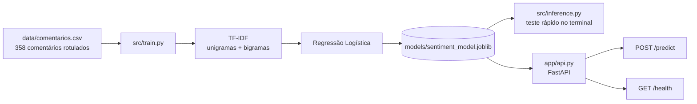

# 🧠 Análise de Sentimentos com Machine Learning


Classificador de sentimentos (**positivo** / **negativo**) para comentários de clientes em português, servido por uma API REST com **FastAPI**.

> Projeto replicado a partir de [LeonardoCardia/mlops_analise_sentimento](https://github.com/LeonardoCardia/mlops_analise_sentimento), para fins de estudo.

## Como funciona



1. **Dados** — `data/comentarios.csv` tem duas colunas: `texto` e `sentimento` (`positivo` ou `negativo`), praticamente balanceadas (180 × 178).
2. **Treino** — `src/train.py` separa 80% para treino e 20% para teste, monta um `Pipeline` do scikit-learn e salva o modelo treinado em `models/sentiment_model.joblib`.
   - `TfidfVectorizer(strip_accents="unicode", ngram_range=(1, 2))` transforma cada frase em números, considerando palavras soltas e pares de palavras (assim "não recomendo" vira uma característica própria, diferente de "recomendo").
   - `LogisticRegression` aprende quais palavras/pares puxam para positivo ou negativo.
3. **Inferência** — `src/inference.py` carrega o modelo e classifica duas frases de exemplo.
4. **API** — `app/api.py` expõe o modelo via HTTP e devolve o sentimento, a **confiança** (probabilidade da classe escolhida) e a versão do modelo. Cada previsão é registrada em log JSON com o sentimento, a confiança e o tamanho do texto (o texto em si não é guardado no log).

## Estrutura

```
.
├── app/
│   └── api.py               # API FastAPI
├── data/
│   └── comentarios.csv      # base rotulada
├── models/
│   └── sentiment_model.joblib  # modelo treinado (gerado pelo train.py)
├── src/
│   ├── train.py             # treino + avaliação + salvamento
│   └── inference.py         # teste rápido do modelo
├── pyproject.toml           # dependências (gerenciadas pelo uv)
└── uv.lock                  # versões exatas travadas
```

## Requisitos

- Python **3.10** ou superior
- [uv](https://docs.astral.sh/uv/) (gerenciador de pacotes e ambientes)

Instalar o uv no Windows (PowerShell):

```powershell
powershell -ExecutionPolicy ByPass -c "irm https://astral.sh/uv/install.ps1 | iex"
```

No Linux/macOS:

```bash
curl -LsSf https://astral.sh/uv/install.sh | sh
```

## Como rodar

```bash
# 0. Clonar o repositório
git clone https://github.com/biaag10/mlops_analise_sentimento.git
cd mlops_analise_sentimento

# 1. Instalar as dependências (cria a pasta .venv automaticamente)
uv sync

# 2. Treinar o modelo (gera models/sentiment_model.joblib)
uv run python src/train.py

# 3. Testar o modelo no terminal
uv run python src/inference.py

# 4. Subir a API
uv run uvicorn app.api:app --reload
```

Com a API no ar, abra **http://127.0.0.1:8000/docs** para testar pelo Swagger.

## Endpoints

### `GET /health`

```json
{ "status": "ok", "versao_modelo": "0.1.0" }
```

### `POST /predict`

Requisição (o texto deve ter entre 3 e 1000 caracteres):

```json
{ "texto": "Adorei o produto, excelente qualidade!" }
```

Resposta:

```json
{
  "sentimento": "positivo",
  "confianca": 0.7819,
  "versao_modelo": "0.1.0"
}
```

Pelo terminal (Linux/macOS/Git Bash):

```bash
curl -X POST http://127.0.0.1:8000/predict \
  -H "Content-Type: application/json" \
  -d '{"texto": "Péssimo atendimento, não recomendo."}'
```

Pelo PowerShell (Windows):

```powershell
Invoke-RestMethod -Method Post -Uri http://127.0.0.1:8000/predict `
  -ContentType "application/json; charset=utf-8" `
  -Body '{"texto": "Péssimo atendimento, não recomendo."}'
```

## Resultados

Métricas no conjunto de teste (20% da base, `random_state=42`):

| Métrica    | Valor |
| ---------- | ----- |
| Acurácia   | 0,903 |
| F1 (macro) | 0,902 |

## Próximos passos

- Adicionar a classe `neutro` e ampliar a base de dados.
- Testes automatizados da API com `pytest` + `TestClient`.
- Containerizar com Docker e publicar o modelo na AWS.

## Limitações

- Só existem duas classes; frases neutras (ex.: "O produto chegou ontem pela manhã.") são forçadas para positivo ou negativo, com confiança perto de 0,5.
- A base é pequena (358 frases) e com vocabulário repetitivo, então as métricas tendem a ser otimistas.
- A confiança costuma ficar entre 0,7 e 0,8 mesmo em frases bem claras, porque a base é pequena.

## Tecnologias

Python · scikit-learn · pandas · FastAPI · Pydantic · Uvicorn · Loguru · joblib · uv

## Autora

**Bianca Andrade Galvão** · [GitHub](https://github.com/biaag10)
